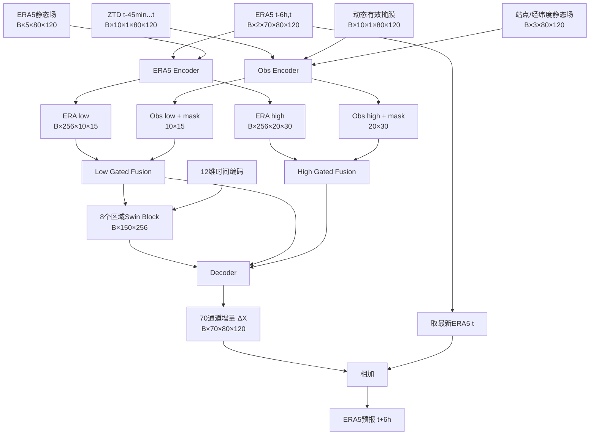

# 当前 ERA5 + GNSS-ZTD 6小时预报网络结构

本文说明当前实际训练和测试所使用的网络，而不是早期方案草稿。对应代码与配置：

- 模型：[model/da_forecast_model.py](model/da_forecast_model.py)
- Swin基础模块：[model/fuxi.py](model/fuxi.py)
- 数据管道：[data/da_dataset.py](data/da_dataset.py)
- 训练入口：[train.py](train.py)
- 当前配置：[configs/train_da_forecast.json](configs/train_da_forecast.json)
- 当前最佳权重：`work_dirs/da_forecast_6h/best.pt`

## 1. 任务定义

网络利用两个ERA5分析场和分析时刻之前的GNSS-ZTD观测，预报未来6小时的ERA5状态：

```text
ERA5(t-6h, t) + GNSS-ZTD(t-45min ... t) -> ERA5(t+6h)
```

空间区域为欧洲：

```text
纬度：36.50°N ... 56.25°N，共80格
经度：-5.25°E ... 24.50°E，共120格
分辨率：0.25°
```

模型输出70个通道：

```text
13层 × (z, t, u, v, r) = 65
t2m、u10、v10、msl、tp = 5
总计70通道
```

其中ERA5输入与监督标签均处于逐通道标准化空间。降水在标准化之前还进行了
`clip(0) -> log1p` 变换。

## 2. 总体结构

模型类为 `DAForecastNet`，由五部分组成：

1. ERA5 Encoder；
2. GNSS-ZTD Obs Encoder；
3. 高、低两个尺度的门控融合；
4. 10×15分辨率的区域Swin Transformer；
5. 带双尺度跳跃连接的增量Decoder。



网络不是直接回归完整未来场，而是预测相对于当前ERA5分析场的增量：

```math
\hat{X}_{t+6}=X_t+\Delta X_\theta
```

## 3. 输入张量

| 输入 | shape | 内容 |
|---|---:|---|
| `era5` | `[B,2,70,80,120]` | 标准化后的ERA5 `t-6h` 和 `t` |
| `era_static` | `[B,5,80,120]` | 从FuXi `conds.npy`按欧洲网格裁剪的5个静态场 |
| `time_features` | `[B,12]` | `t-6h、t、t+6h` 的年周期和日周期sin/cos编码 |
| `obs_ztd` | `[B,10,1,80,120]` | 标准化GNSS-ZTD，5分钟间隔 |
| `obs_mask` | `[B,10,1,80,120]` | 各时次、各格点是否有有限ZTD值 |
| `obs_static` | `[B,3,80,120]` | 站点静态mask、归一化纬度、归一化经度 |

### 3.1 ERA5通道选择

原始label Zarr包含71通道：

```text
0...68：ERA5状态变量
69：IMERG tp
70：ERA5 tp
```

当前任务要求ERA5作为分析场和监督标签，因此实际选择：

```python
list(range(69)) + [70]
```

即不使用IMERG降水作为训练标签。

### 3.2 时间编码

分别取 `t-6h、t、t+6h`，每个时刻构造：

```text
2π × day_of_year / days_in_year
2π × hour / 24
```

三个时刻得到6个相位值，再拼接其sin和cos，最终得到12维向量。

## 4. ERA5 Encoder

ERA5 Encoder分别编码动态ERA5场和静态场，然后在1/4分辨率相加。

### 4.1 动态场Patch Embedding

首先把两个ERA5时次合并到通道维：

```text
[B,2,70,80,120]
 -> reshape
[B,140,80,120]
 -> Conv2d(140,256,kernel=4,stride=4)
[B,256,20,30]
```

### 4.2 静态场Patch Embedding

```text
[B,5,80,120]
 -> Conv2d(5,256,kernel=4,stride=4)
[B,256,20,30]
```

两路特征逐元素相加，再经过一个普通区域卷积ResBlock：

```text
high_era = ResBlock(dynamic_patch + static_patch)
shape = [B,256,20,30]
```

这里的ResBlock包含：

```text
GroupNorm(32) -> SiLU -> 3×3 Conv
GroupNorm(32) -> 3×3 Conv
残差连接
```

### 4.3 低分辨率特征

```text
[B,256,20,30]
 -> Conv2d(256,256,kernel=3,stride=2,padding=1)
 -> ResBlock
[B,256,10,15]
```

ERA5 Encoder最终输出：

```text
high_era：[B,256,20,30]
low_era： [B,256,10,15]
```

## 5. GNSS-ZTD Obs Encoder

Obs Encoder的重点是处理稀疏站点、时次缺测和不规则有效观测数量。

### 5.1 动态有效mask

有效mask定义为：

```python
(obs_mask > 0) & isfinite(obs_ztd)
```

无效或NaN观测首先被置为0。随后把ZTD和mask拼成两个输入通道：

```text
ZTD × mask + mask
[B,10,2,80,120]
 -> permute
[B,2,10,80,120]
```

显式输入mask可以让网络区分：

- 标准化后数值恰好为0的真实观测；
- 因缺测而填0的位置。

### 5.2 时空3D卷积

```text
[B,2,10,80,120]
 -> Conv3d(2,32,kernel=3,padding=1) -> SiLU
 -> Conv3d(32,64,kernel=3,padding=1) -> SiLU
[B,64,10,80,120]
```

卷积同时建模5分钟时间序列和站点邻域空间结构。

### 5.3 Mask-aware时间聚合

每个格点只对有效观测时次求平均：

```math
F_{agg}=\frac{\sum_t F_tM_t}{\max(\sum_t M_t,1)}
```

得到：

```text
temporal_feature：[B,64,80,120]
station_mask：    [B,1,80,120]
```

`clamp_min(1)`保证全缺测时不会除以0。聚合结果再次乘站点mask，从而保证无站点
格点不会产生虚假观测特征。

### 5.4 站点静态信息与Patch Embedding

三个静态通道先乘当前样本的动态站点mask，再与64维观测特征拼接：

```text
[64维观测特征, 3维静态信息]
 -> [B,67,80,120]
 -> Conv2d(67,256,kernel=4,stride=4)
[B,256,20,30]
```

同时对站点mask做4×4最大池化：

```text
high_mask：[B,1,20,30]
```

高分辨率观测特征经过ResBlock后再次乘 `high_mask`：

```text
high_obs：[B,256,20,30]
```

然后下采样：

```text
high_obs
 -> Conv2d(256,256,kernel=3,stride=2,padding=1)
 -> ResBlock
 -> × low_mask
low_obs：[B,256,10,15]
```

其中：

```text
low_mask：[B,1,10,15]
```

Obs Encoder最终返回 `high_obs、low_obs、high_mask、low_mask`。

## 6. 双尺度门控融合

高尺度20×30和低尺度10×15分别使用一个独立的 `GatedFusion`，参数不共享。

以任意一个尺度为例，先拼接：

```text
ERA特征：  256通道
Obs特征：  256通道
Patch mask：1通道
总输入：   513通道
```

观测修正量由下面的卷积网络生成：

```text
Conv2d(513,256,3,padding=1)
 -> SiLU
 -> Conv2d(256,256,3,padding=1)
 -> delta_feature
```

融合公式为：

```math
F_{fused}=F_{era}+A\cdot\sigma(g)\cdot\Delta F
```

其中：

- `g` 是 `[1,256,1,1]` 的可学习逐通道门控参数；
- 初始值为 `-4`，所以初始门开度 `sigmoid(-4)=0.01799`；
- `A` 表示该样本在当前尺度是否至少有一个有效观测patch；
- 若整个样本无观测，则 `A=0`，融合结果严格等于ERA5特征。

当前20 epoch最佳权重中的门控统计为：

| 融合尺度 | sigmoid(gate)均值 | 最小值 | 最大值 |
|---|---:|---:|---:|
| high，20×30 | 0.01941 | 0.01875 | 0.02084 |
| low，10×15 | 0.01875 | 0.01834 | 0.01923 |

门控仍保持较小，说明当前模型以ERA5为主干，只允许观测分支提供小幅特征修正。

## 7. 区域Swin Transformer主干

主干只在低分辨率 `10×15` 特征上运行。

### 7.1 Token化和时间条件

```text
[B,256,10,15]
 -> flatten + transpose
[B,150,256]
```

12维时间特征经过：

```text
Linear(12,256) -> SiLU -> Linear(256,256)
```

投影结果广播到150个token并与token相加。

### 7.2 四组Swin Layer

当前配置：

```text
depths = [2,2,2,2]
总Swin Block数 = 8
embed_dim = 256
num_heads = 8
每个head维度 = 32
window_size = 5×5
mlp_ratio = 4
```

10×15特征正好可划分为：

```text
2 × 3 = 6个窗口
每个窗口25个token
```

每组的两个Block交替使用：

```text
Block 1：不移动窗口，shift=0
Block 2：移动窗口，shift=2
```

单个Swin Block包含：

1. LayerNorm；
2. Window Attention V2；
3. 第一个残差连接；
4. LayerNorm；
5. GEGLU前馈网络；
6. 第二个残差连接。

Attention使用余弦注意力、可学习logit scale和连续相对位置偏置。

### 7.3 欧洲区域边界

移动窗口使用 `mask_type="hw"`，即同时阻止纬度和经度两个方向在roll之后跨区域边界
产生错误注意力连接。

这与全球FuXi默认只处理部分周期边界的设置不同。当前新模型中的所有卷积也都显式使用
普通 `nn.Conv2d`，不使用 `PeriodicConv2d`，因此欧洲最西侧不会与最东侧相连。

### 7.4 多深度特征合并

每组Swin Layer的输出都被保留：

```text
4 × [B,150,256]
 -> concat
[B,150,1024]
 -> Linear(1024,256)
 -> LayerNorm
[B,150,256]
 -> reshape
[B,256,10,15]
```

注意：四组Swin之间不再下采样，空间尺寸始终为10×15。

## 8. Forecast Decoder

Decoder使用融合后的low/high特征作为两级跳跃连接。

### 8.1 Low skip融合

```text
Transformer输出：[B,256,10,15]
low skip：       [B,256,10,15]
 -> concat
[B,512,10,15]
 -> ResBlock(512,256)
[B,256,10,15]
```

### 8.2 上采样与High skip融合

```text
[B,256,10,15]
 -> ConvTranspose2d(256,256,kernel=4,stride=2,padding=1)
[B,256,20,30]
 -> concat high skip
[B,512,20,30]
 -> ResBlock(512,256)
[B,256,20,30]
```

### 8.3 输出增量

```text
[B,256,20,30]
 -> ConvTranspose2d(256,70,kernel=4,stride=4)
[B,70,80,120]
```

最后一层权重初始化为标准差 `1e-3` 的小随机数，bias初始化为0。这样模型初始输出接近
ERA5持久性预报，同时第一步训练时仍能向前面模块传播非零梯度。

最终输出：

```python
forecast = era5[:, -1] + delta
```

## 9. 完整shape流

| 阶段 | shape |
|---|---:|
| ERA5输入 | `[B,2,70,80,120]` |
| ERA5合并时次 | `[B,140,80,120]` |
| ERA high | `[B,256,20,30]` |
| ERA low | `[B,256,10,15]` |
| ZTD输入 | `[B,10,1,80,120]` |
| ZTD+mask 3D卷积输入 | `[B,2,10,80,120]` |
| 时间聚合后Obs特征 | `[B,64,80,120]` |
| Obs high | `[B,256,20,30]` |
| Obs low | `[B,256,10,15]` |
| High融合 | `[B,256,20,30]` |
| Low融合 | `[B,256,10,15]` |
| Swin token | `[B,150,256]` |
| 四组输出拼接 | `[B,150,1024]` |
| 主干输出 | `[B,256,10,15]` |
| Decoder第一次上采样 | `[B,256,20,30]` |
| 预测增量 | `[B,70,80,120]` |
| 最终预报 | `[B,70,80,120]` |

## 10. 参数量

当前配置共有 `22,196,390` 个参数，全部参与训练。

| 模块 | 参数量 | 占比 |
|---|---:|---:|
| ERA5 Encoder | 3,546,880 | 15.98% |
| Obs Encoder | 3,284,256 | 14.80% |
| High Gated Fusion | 1,772,544 | 7.99% |
| Low Gated Fusion | 1,772,544 | 7.99% |
| Swin Backbone | 6,678,848 | 30.09% |
| Decoder | 5,141,318 | 23.16% |
| 总计 | 22,196,390 | 100% |

## 11. 训练损失

网络在标准化空间中训练，损失为：

```math
L=L_{global}+0.5L_{halo}
```

### 11.1 全欧洲损失

```math
L_{global}=\frac{\sum |\hat X-X|M\,w(\phi)}{\sum M\,w(\phi)}
```

其中：

- `M` 为ERA5标签有限值mask；
- `w(φ)=cos(φ)`，并归一化为区域平均值1；
- 70个通道共同求加权平均。

### 11.2 站点邻域损失

对静态站点mask做半径3格的最大池化，形成每个站点周围7×7区域，再在这个区域计算同样
的纬度加权MAE，得到 `L_halo`。

因此站点附近格点既参与全局损失，也以0.5的附加权重参与halo损失。

## 12. 当前训练配置

```text
optimizer：AdamW
初始学习率：2e-4
最低学习率：1e-6
weight decay：0.05
warmup：100 optimizer steps
scheduler：warmup + cosine decay
epoch：20
每卡batch size：8
GPU数：4
全局batch size：32
混合精度：BF16
梯度裁剪：1.0
```

数据划分：

| 集合 | 时间范围 | 样本数 |
|---|---|---:|
| Train | 2022-01-01至2024-05-01 | 3402 |
| Validation | 2024-05-01至2025-01-01 | 979 |
| Test | 2025-01-01至2025-10-01 | 1091 |

时间范围均按左闭右开处理，且每个样本的监督时刻必须位于对应集合内部。

## 13. 无观测消融模式

构造模型时设置：

```python
DAForecastNet(use_obs=False)
```

会完全不创建以下模块：

- Obs Encoder；
- High Gated Fusion；
- Low Gated Fusion。

ERA5 Encoder、Swin Backbone和Decoder保持不变，可用于结构一致的ERA5-only消融。

这不同于简单把ZTD填0：`use_obs=False`是真正删除观测分支及其参数。

## 14. 关键实现特点与限制

### 14.1 当前输入是ZTD，不是innovation

Obs Encoder当前输入标准化后的原始GNSS-ZTD以及有效mask，没有预先计算
`obs_ztd - background_ztd`。观测与ERA5的差异由双Encoder和融合层隐式学习。

### 14.2 观测只使用分析时刻之前的数据

观测窗口严格为：

```text
t-45、t-40、...、t-5、t，共10帧
```

不使用 `t` 之后的观测，不存在未来观测泄漏。

### 14.3 全缺测样本退化为ERA5分支

若某个样本10帧ZTD全部缺测：

- Obs特征被mask为0；
- `available=0`；
- 两个融合层严格返回ERA5特征；
- 网络不会因卷积bias产生伪观测修正。

### 14.4 单步6小时模型

当前监督目标只有 `t+6h`，不是多步联合训练。若要生成更长时效，需要把输出递归作为后续
ERA5输入，这会产生误差累积；正式做多步预报前应单独进行自回归训练或多步微调。

### 14.5 融合门较小不等于观测没有作用

门控作用于256维隐空间修正量，其数值不能直接解释为预报场中“观测占比”。判断观测价值
仍应以 `use_obs=True` 对比 `use_obs=False`、打乱ZTD、全缺测ZTD等消融结果为准。
